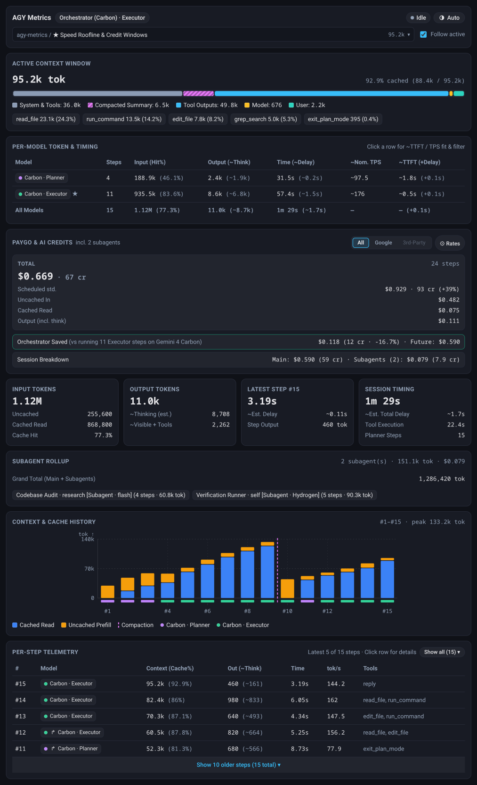
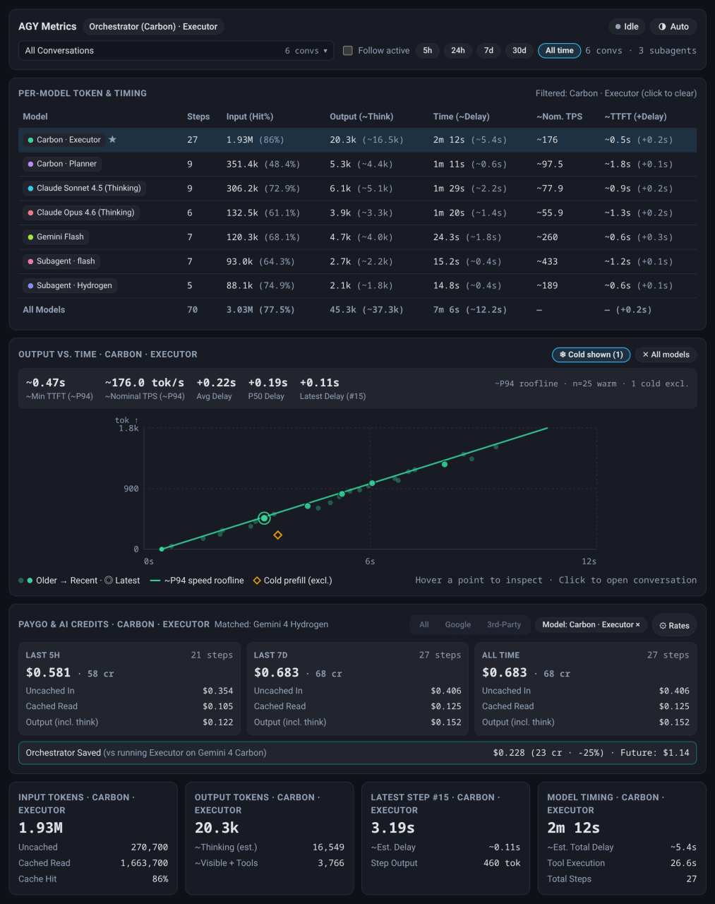

# AGY Metrics

A local telemetry dashboard plugin for **Antigravity Desktop**. It runs in the Auxiliary Pane with zero external dependencies (Python 3.10+ stdlib only) and 100% offline operation.

> Using **antigravity-cli**? Check out [**agystats**](https://github.com/Jamesits/agystats), a port of this project for `antigravity-cli`.

| Live Session Telemetry | Cross-Session Rollup & Speed Roofline |
| :---: | :---: |
| [](assets/screenshot-session.png) | [](assets/screenshot-roofline.png) |

## Features

- **Tokens & Context Window** — Tracks uncached vs. cached input tokens, cache hit %, estimated thinking vs. visible output, subagent rollups, and live context breakdown across compactions.
- **Model & Orchestrator Attribution** — Breaks down steps, tokens, and timing per model and across Orchestrator `Planner` / `Executor` phases. Click any model row to filter the view.
- **Latency & Speed Roofline** — Measures per-step inference time, `tok/s`, and retry wait, with an on-demand scatter plot estimating uncongested TTFT, nominal throughput, and serving delay.
- **Offline Cost & AI Credits** — Estimates Paygo `$` and AI Credits across `5h`, `7d`, and total windows, including `Google` / `3rd-Party` pool filters, Orchestrator savings, and editable local rates (`⚙ Rates`).
- **Project, Session & Cross-Session Views** — Navigate by project, conversation, or subagent, follow the active session in real time, or aggregate across a project or **All Conversations** (`5h`, `24h`, `7d`, `30d`, `All time`).
- **Theme Sync** — Matches Antigravity's theme automatically (`Auto` / `Dark` / `Light`).

## Install

Requires **Antigravity Desktop** and **Python 3.10+**.

```bash
python3 install.py
```

Restart Antigravity Desktop once after installing, then open **AGY Metrics** in the Auxiliary Pane.

To upgrade an existing installation, check status, or uninstall:

```bash
python3 install.py --upgrade
python3 install.py --status
python3 install.py --uninstall
```

## Development

Run syntax, manifest, bundle, and unit tests:

```bash
python3 scripts/check.py
```

## Notes & Contributing

- **100% vibe-coded (by design)** — This project is built with AI agents and meant to stay that way; I don't plan to read or hand-curate every line of code.
- **Personal tool, Linux-tested** — Built around my own usage and currently tested only with Antigravity Desktop on Linux. I hope others find it useful, though I can't make any guarantees.
- **Light-touch maintenance** — I plan to keep this working as I use it, without putting heavy effort into it.
- **PRs welcome** — If you make local fixes or improvements, please be generous and share them back!

## License

[MIT](LICENSE) © David Gao
